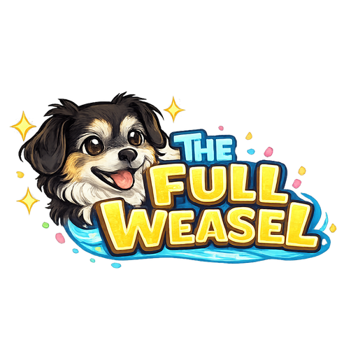

<div align="center">
  
</div>

<div align="center">


[](https://github.com/sponsors/westkitty)
[](https://ko-fi.com/westkitty)

</div>

# The Full Weasel 🦦🎂

A birthday-themed rhythm game PWA where you help Dexter catch delicious treats and dodge sharks in sync with the music. Built with React + Vite for a buttery-smooth mobile-first experience.

## Key Features

- **Three-Round Gameplay:** Progress through increasingly challenging rounds by filling your party meter to 100%
- **Lane-Based Catching:** Swipe left/right to catch Nana's Cheese and Iced Tea as they fall
- **Shark Dodging:** Tap center to jump over horizontal sharks swimming across the screen
- **Combo System:** Build consecutive catches for a 🔥 combo multiplier badge
- **Perfect Timing Bonus:** +4 extra points for catching items at the optimal moment
- **Celebration Poses:** Dexter cycles through 5 expressive poses (joyful, excited, proud, focused, neutral) on each catch
- **Strip Phase Finale:** Rapid-tap bonus phase at the end with dramatic zoom
- **Victory Celebration:** Confetti explosion with the iconic "You can leave your hat on" payoff
- **Haptic Feedback:** Distinct vibration patterns for perfect catches, normal catches, and shark hits
- **Touch Ripples:** Visual feedback on every tap
- **Offline Support:** Service worker caches sprites for offline play (media requires network)

## Installation

### Option A: Play Online
**[Play The Full Weasel](https://westkitty.github.io/The_Full_Weasel/)** — tap **Add to Home Screen** when prompted to install as a PWA.

### Option B: Run Locally

**Fast Track (One-Liner):**
```bash
git clone https://github.com/westkitty/The_Full_Weasel.git && cd The_Full_Weasel && npm install && npm run dev
```

**Step-by-Step Guide:**

1. **Clone the repository:**
   ```bash
   git clone https://github.com/westkitty/The_Full_Weasel.git
   ```

2. **Enter the project folder:**
   ```bash
   cd The_Full_Weasel
   ```

3. **Install dependencies:**
   ```bash
   npm install
   ```

4. **Start the development server:**
   ```bash
   npm run dev
   ```
   
5. **Open in browser:** Navigate to `http://localhost:5173`

### Option C: Build for Production

```bash
npm run build
```

The build copies governed derivatives from `assets_optimized/`: lossless WebP
images and H.264 `faststart` background loops. Originals remain in
`assets_raw/` and `assets_backgrounds/`. Maintainers with ImageMagick and
FFmpeg can regenerate the derivatives with `npm run optimize-media`.

The optimized build will be output to the `dist/` folder, ready for deployment to any static hosting service (Netlify, Vercel, GitHub Pages, etc.).

## Installing as a PWA on Android

The Full Weasel is designed as a Progressive Web App for the best mobile experience. Here's how to install it on your Android device:

### Method 1: Browser Prompt
1. Open the game in **Chrome** or **Edge** on your Android device
2. Play for a few seconds — the browser will detect it's a PWA
3. Look for the **"Add to Home Screen"** banner at the bottom
4. Tap **Install** and confirm
5. The app icon will appear on your home screen

### Method 2: Manual Installation
1. Open the game URL in **Chrome**
2. Tap the **three-dot menu** (⋮) in the top-right corner
3. Select **"Add to Home screen"** or **"Install app"**
4. Name it (default: "Full Weasel") and tap **Add**
5. Find the icon on your home screen and launch!

### Method 3: Samsung Internet
1. Open the game in **Samsung Internet**
2. Tap the **menu icon** (three lines)
3. Select **"Add page to"** → **"Home screen"**
4. Tap **Add**

Once installed, the game runs in standalone mode (no browser UI), supports offline sprite caching, and feels like a native app.

## How to Play

| Action | Control |
|--------|---------|
| Move Left | Tap left side of screen |
| Move Right | Tap right side of screen |
| Jump (dodge sharks) | Tap center of screen |
| Strip Phase | Tap rapidly anywhere |

**Objective:** Fill the party meter to 100% by catching cheese 🧀 and iced tea 🍵 while avoiding sharks 🦈. Complete all 3 rounds to reach the epic finale!

## Tech Stack

- **React 18** — UI framework
- **Vite 7** — Lightning-fast build tool
- **CSS Animations** — Smooth wobble effects & transitions
- **Web Audio API** — Music playback with crossfade
- **Service Worker** — Offline caching for PWA
- **Vibration API** — Haptic feedback patterns

## Project Structure

```
The_Full_Weasel/
├── src/
│   ├── App.jsx          # Main game logic & state machine
│   ├── App.css          # All styling & animations
│   └── main.jsx         # React entry point
├── public/
│   ├── assets/          # Processed sprites, backgrounds, music
│   ├── icons/           # PWA icons
│   ├── manifest.webmanifest
│   └── sw.js            # Service worker
├── assets_raw/          # Source artwork
├── assets_backgrounds/  # Source video backgrounds
├── assets_music/        # Source audio tracks
└── scripts/
    └── prepare-assets.mjs  # Asset pipeline
```

## Development

```bash
# Start dev server with hot reload
npm run dev

# Start dev server accessible on LAN (for mobile testing)
npm run dev -- --host

# Build for production
npm run build

# Preview production build
npm run preview

# Process assets only
npm run prepare-assets
```

## Governance

Remain ungovernable so Dexter approves.

### **Public Domain / Unlicense**

This project is dedicated to the public domain. You are free and encouraged to use, modify, and distribute this software without any attribution required.

You could even sell it... if you're a capitalist pig.

---

## Why Dexter?

*Dexter is a small, tricolor Phalène dog with floppy ears and a perpetually unimpressed expression... ungovernable, sharp-nosed and convinced he's the quality bar. Alert, picky, dependable and devoted to doing things exactly his way: if he's staring at you, assume you've made a mistake. If he approves, it means it works.*

🎂 **Happy Birthday, you magnificent weasel!** 🎂
